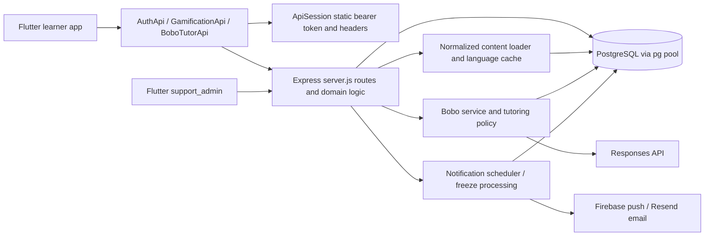

# HowBuddy audit and refactor plan

Audit date: 2026-10-27. Scope: learner Flutter app, Express API, PostgreSQL integration, and relevant support-admin integration. The original audit below is retained as historical evidence; its `server.js` references now refer to code extracted into `server/src/app.js`. Implementation status and current references are maintained in the ledger below. No commits, pushes, deployments or production-data changes have been made.

## Implementation ledger (working backlog)

**Latest user checkpoint:** keep current demo rewards; Google Ads API/production verification will be implemented later. Complete final verification (item 4) and push a refactor branch; defer items 5–10 to the next session. This supersedes the unanswered reward-policy question below. Node 22 is now required by the patched sanitizer; CI and `server/.node-version` are aligned. Latest verified results: root analyzer clean, all 37 Flutter tests passed, all 95 server tests passed on portable Node 22.23.4 against disposable PostgreSQL, with no skipped DB tests. Final web-build results are recorded in the push handoff. The detailed ledger below still needs the deferred final synchronization for the latest lesson/profile controllers and structured grader.

**Item 4 completed:** learner analyzer clean; support-admin analyzer clean; 37/37 Flutter tests and 95/95 server tests passed; learner and support-admin release web builds succeeded. Non-failing notices remain for the existing Cupertino font reference and available package updates. Verified implementation is being saved on `refactor/howbuddy-reliability`, without merging/deploying or applying production migrations. Items 5–10 remain deferred as requested.

The implementation is **not declared complete or ready for production**. Verified batches are distinguished from remaining code work and environment/product gates. The pre-existing untracked plan was preserved. No repository AGENTS.md was found in the inspected app/server/admin paths. See [REGRESSION.md](REGRESSION.md) for downstream acceptance commands and [migration notes](server/migrations/README.md) for compatibility and recovery.

| Batch / findings | Skills applied and changes | Evidence / measurement | Remaining limitations |
| --- | --- | --- | --- |
| Baseline and test boundary (F08, test gaps) | codebase-onboarding, change-impact, flutter-dart-code-review, tdd-workflow, module-regression, backend-patterns, error-handling. Fixed 9 baseline missing-brace infos mechanically; extracted side-effect-free `createHowBuddyApi` in `server/src/app.js`, kept `server.js` as startup CLI, added Express 4 rejected-promise boundary in `http_app.js`. `npm test` now discovers files; lockfile and verification CI added. | Baseline recheck reproduced 6/73 passing tests and 9 analyzer infos. New HTTP test initially failed due to missing implementation, then passed. Root analyzer subsequently clean. Constructor tests use injected DB and disable outbound integrations. | CI configuration has not run on GitHub. Learner tests do not verify a separate admin build. |
| Completion/session integrity (F01, completion portion F02, F04) | postgres-patterns, database-migrations, api-design, security-review, tdd-workflow. `lesson_completion.js`: atomic account lock, prerequisite validation, heart-backed server session, idempotent start key, per-session answer rows, server grade and duration, one lifetime XP award, per-session completion receipt. Tutor projection and session answer save share a transaction. Flutter consumes server `correct`; duplicate local grader removed. | `lesson_completion.test.js` runs real PostgreSQL rollback after progress insertion, 6 concurrent completions, receipt replay across dates, new practice study day without duplicate XP, stale answer revisions, locked lesson, no hearts and missing grant. `app.test.js` exercises register/login/start/attempt/complete, two simultaneous sessions with different answers, duplicate start with one heart charge, content-deletion replay and account isolation. | Coordinated API/client rollout required. Start keys survive retries while node is mounted, but not app/process death. Admin content edits that invalidate a paid session have no automatic refund policy. All exercise types/delimiter edge cases still need a broader contract fixture set. |
| Study days (F03) | postgres-patterns, api-design, security-review. `study_date.js` uses server clock in validated timezone/offset; arbitrary `X-Client-Date` no longer authoritative. Removed history-moving SQL from getGameState. | DST/offset tests plus HTTP regression prove a future-dated recorded study day survives game-state read. Existing histories are preserved; no guessed repair/backfill. | User-requested timezone changes remain accepted; no historical reattribution. Game-state read still performs existing recharge/freeze maintenance. |
| Client transport and async ownership (F05–F07) | dart-flutter-patterns, error-handling, flutter-dart-code-review, tdd-workflow. `api_transport.dart` owns whole-response deadline, safe JSON shape/status mapping, stale-session rejection and authenticated-401 invalidation; learner services share client/base URL. `async_resource_ownership.dart` and notification service serialize/coalesce session-owned registration and clean failed initialization. Late ads and timeout/show paths dispose resources. `latest_request.dart` protects Home against stale reads after newer state. | Transport tests cover non-JSON/array/null, deadline including response body, session switch, one write attempt and 401 ownership. Six resource tests cover registration ownership/queue recovery and late resource disposal. Controlled latest-request test rejects old reads. | Physical FCM/APNS/ads and account-switch behavior need devices/configuration. SDK callbacks do not carry initiating registration IDs. HTTP timeout does not prove server cancellation; writes therefore have no automatic retries. Admin app transport is intentionally still separate. |
| Content and migrations (F08–F09) | backend-patterns, postgres-patterns, database-migrations, security-review. `revision_cache.js` checks DB generation across replicas, coalesces loads and rejects stale in-flight results. Migration 002 triggers bump generation within content transactions. Start/completion hold a shared generation lock and reject snapshots superseded before lock acquisition. Last-topic and analytics reads now use current content. `npm run migrate` is explicit; startup no longer runs DDL and demo/history utilities are opt-in. | Cache tests cover publication during an in-flight load, coalescing and separate-instance invalidation. Real-DB migration test runs twice and verifies rolled-back publication does not bump generation. An initial test exposed historical `public` cleanup in the legacy content schema; bootstrap now executes only CREATE section and never those DROP jobs. | No production-sized lock/upgrade rehearsal. New migrations are undeployed; make immutable after deployment. Fresh tables require normalized lesson content. No live multi-replica deployment exercised. |
| Structural refactor and cleanup (F10, F14) | orch-refine-code, dart-flutter-patterns, flutter-dart-code-review. Extracted XP widget, chat message widget, transport, ownership helpers, completion service, study-date policy, migration runner and cache. Removed declaration-only `socialSignUp`, `fetchLessonLevels`, `DevelopmentPage` after repository reference checks; retained `lessonShapeIcon`, dynamically named glasses, launcher artwork, runtime dependencies and intentional dev mock. | Analyzer/tests and learner release build verify changed references. Native review delegation found and prompted fixes for practice semantics, duplicate heart charging, concurrent answer storage and stale legacy content ownership. | Large LessonPage/Profile widgets and broad AuthApi still warrant further controller/domain extraction. Admin/learner shared DTO/package consolidation and optional artwork deletion were not forced. No runtime dependency was proven unused. |
| Measured performance (F11) | benchmark-optimization-loop; benchmark-methodology inspected and rejected as competitor-scoring guidance, not runtime profiling. XP future is owned by state and invalidated on account/loader change; XP screen extracted and retry added. | Same widget rebuild scenario: **2 requests before → 1 after**; changing account still makes a new request. Test first failed at expected 1/actual 2, then passed. Learner release web build succeeded; its observed 39.5s compile is a build observation, not an improvement claim. | No controlled device startup, frame-time, scrolling, memory, PostgreSQL production-data query latency, scheduler throughput or real Bobo-provider benchmark. No speculative index or latency claim. Tab disposal policy unchanged. |
| Visual/accessibility/motion pilot (F12–F13) | make-interfaces-feel-better, accessibility, click-path-audit, flutter-dart-code-review, dart-flutter-patterns; design-system adapted to Flutter ThemeExtension rather than CSS. `AppPalette` is the color definition; theme construction respects explicit brightness independently of legacy adapter. Chat bubbles have role labels, selectable text, consistent spacing/contrast surfaces and 180ms native arrival motion. Suggestions scroll horizontally so large text leaves reply visible; send disables for empty/loading states, failures restore drafts, keyboard focus is owned/disposed. Lesson switch/choice motion respects reduced motion. Blanks have labels, choice controls expose selected semantics/48px targets, resource buttons are >=48px; new role/answer/demo-ad text is translated. | Seven visual/behavior tests cover 360px light/dark at 100%/200% text with reduced motion, sending, loading/error/retry/empty state, keyboard draft recovery and word-choice semantics/targets. Inspected generated PNGs with locally installed Arial and Flutter Material icons. Large-text test initially exposed wrapped suggestions hiding latest replies, fixed and retested. `tool/ui_preview.dart` runs real widgets with synthetic callbacks and no provider/API calls. | Browser inspection was attempted but computer-use stopped because it could not determine Chrome URL confidently. Test-renderer PNG inspection is not an interactive browser/device sign-off. No VoiceOver/TalkBack, physical keyboard/IME, landscape/tablet/full-app screenshot audit or animation frame profiling. Further visual extension across the app is pending pilot verification in a running browser/device. Legacy AppColors adapter and duplicated profile/language ownership remain. |

### Current finding disposition

- **Implemented with automated evidence:** F01, F03, F04's duplicate grading, learner F05 core transport, F06, F07 stale-read/ad ownership, F08 error/startup/migration boundary, F09 revision consistency.
- **Partially implemented:** F02 (session-backed completion done; ad-reward verification pending), F10 (several extracted services/widgets, larger controllers still pending), F11 (measured XP requests fixed; other profiling unavailable), F12 (single palette definition/theme construction fixed; account/language state consolidation pending), F13 (chat/lesson pilot and specific targets/semantics fixed; full-app visual/accessibility sign-off pending), F14 (verified dead declarations removed; optional assets/admin duplication retained).
- **Product gate:** user was asked whether unverified ad rewards should be restricted to explicit demo mode and disabled for production, or remain enabled by default. No choice received yet. Existing demo reward behavior has been preserved; `/gamification/heart-video` and `/gamification/emerald-video` remain unverified grants and are a production blocker. Native AdMob still uses test units. Do not claim trusted production ad rewards.

### Skills and host adaptations

All selected skills are installed. TDD's checkpoint commits and orch-pipeline's routine approval/commit gates were intentionally omitted under the user's explicit autonomous/no-commit instruction. Native Node/Flutter tests replace React/Playwright examples; no unrelated framework/tool was installed. The computer-use skill references a node_repl/sky entry point not exposed here; the provided cua_repl native surface was used and stopped on its own URL-policy check. Its restriction was respected; no alternate browser-control mechanism was attempted. Design-system tokens are Flutter ThemeExtension values; no CSS/HTML design system was introduced.

### Verification and security report

Final counts/commands are recorded below after the last run. Initial baseline failures remain above; implementation-introduced failing tests/analyzer issues were fixed before the associated batch was marked verified. No numeric coverage target is claimed. The current tests focus on invariants, not full app coverage.

Security review and independent backend review found no new critical/high issue in the final session/replay/transaction ownership code. Production readiness remains **blocked** by unresolved ad-reward policy, coordinated rollout/migration rehearsal and device/browser gates. SQL inputs remain parameterized; test DB accepts only loopback `howbuddy_test` role/database, uses a random disposable schema, never reads `.env` or production `DATABASE_URL`. Production data was never used. No external audit service received repository contents. Dependency installation reported 10 vulnerabilities (1 low, 9 moderate); a later offline npm audit returned zero from offline data, which is **not** accepted as evidence that the installation findings are resolved. A current authorized dependency-advisory review remains outstanding.

### Next implementation order

1. Resolve the explicit demo/production reward-policy choice; implement and test one-use verified server claims or disabled production reward controls accordingly.
2. Complete running-browser/device pilot verification, then extend shared presentation/error/feedback patterns to auth, profile, notepad and gamification; verify semantics, keyboard, narrow/large text and landscape.
3. Extract remaining lesson/profile controllers and consolidate language/account preference ownership without a state-framework migration; broaden all-exercise fixtures and learner end-to-end journeys.
4. Run production-sized migration/restore rehearsal and device startup/frame/memory plus DB/scheduler/Bobo-provider baselines; optimize only demonstrated bottlenecks. Validate independent admin build and CI execution.

### Reproduce local rendered evidence

`flutter test test/learning_visual_test.dart` writes `build/audit/bobo-{light,dark}-{1,2}x.png` (ignored build artifacts). For readable typography rather than Flutter's Ahem test font, set `HOWBUDDY_TEXT_FONT` to a local Arial TTF and `HOWBUDDY_ICON_FONT` to the SDK `materialicons-regular.otf` before that command. These fonts were read locally and not copied into the repository. The preview harness can be run locally with `flutter run -d web-server --web-hostname 127.0.0.1 --web-port 8091 -t tool/ui_preview.dart`; it never contacts the API or tutoring/ad providers.

## Baseline verification

| Command | Observed result before code changes |
| --- | --- |
| `flutter analyze` (repository root) | Exit 1: 9 info-level `curly_braces_in_flow_control_structures` diagnostics. `support_admin/lib/features/admin/admin_analytics_sections.dart:303`; `support_admin/lib/features/admin/content_admin_section.dart:287,317,357,360,392,427,473,578`. No other diagnostics reported. |
| `flutter test` (repository root) | Exit 0: all 6 tests passed across two files. |
| `npm test` (`server/`) | Exit 0: all 73 tests passed across nine explicitly enumerated test files. |

Node initially failed under the sandbox with EPERM resolving `C:\Users\Konst`; an approved external-sandbox rerun passed. Sandboxed Flutter invocations produced no output during observation; approved reruns supplied the results above. These tooling limitations are not product failures. The analyzer diagnostics are the existing baseline; the findings below are additional static audit observations, not newly introduced regressions. No database migrations, live API requests, device tests, or production writes were performed. Passing server tests does not establish real PostgreSQL transaction or HTTP-route correctness.

## Architecture and ownership

The repository is a multi-application workspace rather than a shared Dart package architecture. Flutter uses local StatefulWidget state, imperative Navigator routes, manually constructed services, static session/language state, and shared preference storage for UI preferences. HTTP JSON DTOs are manually parsed. The API uses JavaScript ES modules, Express 4, raw parameterized PostgreSQL queries, and an application-wide pool; there is no ORM. Root Dart SDK constraint is `^3.11.5`; Node dependencies include Express `^4.21.2` and pg `^8.13.1`.

| Area | Entry points and responsibilities |
| --- | --- |
| Startup / authentication | `lib/main.dart:14`: timezone, language, notifications, ads, theme, then runApp; splash goes to LoginPage. `lib/features/auth/auth_pages.dart`: registration/login, Google identity, onboarding/navigation. |
| Learner shell / profile / XP | `lib/features/home/home_page.dart:19`: navigation, account preference copies, game-state refresh, profile saves, XP rendering. |
| Learning | `lesson_tree.dart`: server tree plus local completion overlay and heart consumption; `lesson_page.dart`: exercise state, local grading, attempt submission, tutor access, completion; `exercise_interactions.dart`: specialized input widgets. All under `lib/features/learning/`. |
| Client data access | `lib/services/auth_api.dart` handles authentication plus lessons, XP, notepad, preferences and legal acceptance. `api_session.dart` handles shared headers and a second JSON transport implementation. `gamification_api.dart`, `bobo_api.dart` handle other endpoints. |
| Presentation infrastructure | `lib/app_style.dart`, `lib/shared/app_widgets.dart`, `theme_preferences.dart`, `ui_translations.dart`; translations use English source strings as lookup keys. |
| Backend | `server/src/server.js`: app construction, middleware, all route registration, auth/session helpers, content cache, rewards/progress, analytics, startup/schema/seed operations. Dedicated modules implement content editing, tutoring, notifications, translation and support inbox. |
| Persistence | `server/schema.sql`: accounts, legal acceptance, progress/XP, study days, game balances, tutor history, notifications. `server/content_schema.sql`: normalized editable/localized lesson content. Startup executes schemas (`server.js:2096`) and loads content before listening. |
| Auxiliary app / delivery | `support_admin/lib/main.dart`, `features/admin/`, duplicated auth/session/DTO files. `render.yaml`, build scripts and `.github/workflows/android-demo.yml` describe deployment/build. `server/dev-server.js` is an intentional in-memory mock, not the production entry point. |

Conventions: Dart snake_case files, JS snake_case modules, inline widget/domain state, broad catch with feature-specific fallback messages; server tests use node:test and injected fake dependencies. Flutter tests use flutter_test but currently exercise helpers rather than full pages. `analysis_options.yaml:1` includes flutter_lints without strict analyzer options. Git status was clean at audit start.

## Important journeys and data flow

1. **Register/sign in:** auth page calls AuthApi or Google identity, API verifies credentials/token, reads/writes accounts, returns bearer session and Account. AuthApi installs the token in ApiSession. Preferences/legal onboarding precede the learner shell. Session token is process memory; startup returns to login, while UI preferences persist separately.
2. **Choose topic and begin lesson:** Home restores server last-topic preference, with queued notification target taking precedence (`home_page.dart:113`). Tree loads `/lessons/tree`; backend overlays PostgreSQL lesson_progress on cached content (`server.js:1741`). Heart consumption is a separate `/gamification/consume-heart` request before lesson navigation.
3. **Answer and finish:** LessonPage fetches localized exercises, then prior tutor attempts (`lesson_page.dart:61`). `_checkAnswer:182` grades locally and submits `/bobo/attempts`; server independently grades for trusted tutoring. `_finishLesson:295` posts score/count/duration to `/lessons/complete`; backend writes progress, study day, freeze rewards and XP, then client reloads tree/game state.
4. **Ask Bobo:** lesson/exercise context opens chat; authenticated conversation/attempt/message endpoints call `bobo_service.js` and tutoring policy. Server-loaded lesson context and recorded attempts gate assistance; conversation/history and daily reservations persist in PostgreSQL. Provider failures are covered by service tests, not a complete learner UI journey.
5. **Rewards/streaks:** learner consumes hearts, watches native rewarded ad (web simulates), posts reward endpoint, or buys timed XP boost. API updates game row and returns derived game state. Scheduler/freeze policy handles local calendar days and durable delivery claims.
6. **Profile/language/notifications:** profile optimistically updates local fields and parent Account copies, persists API preferences, updates static translation language and shared preferences. NotificationService registers devices and queues topic links through login; Home subscribes and navigates. Account deletion uses authenticated DELETE and clears session.
7. **Content administration:** separate Flutter admin app uses authenticated admin routes to edit/publish/translate/restore normalized content; backend reloads or clears process-local content caches. This affects learner exercises and tree structure.

## Findings and evidence

Priority: P0 = integrity/trust boundary first; P1 = correctness and reliability; P2 = maintainability/performance/accessibility; P3 = verified cleanup. Risk below means implementation risk. Static evidence is distinguished from unmeasured or conditional behavior.

### F01 — Completion writes can partially commit (P0, confirmed structure)

Evidence: `server/src/server.js:1401-1503` uses independent pool.query calls for lesson_progress, study_days, freeze award and lesson_xp; there is no encompassing transaction. Failure after progress insertion can unlock lessons without XP or leave an awarded freeze despite an error response. Unique XP/progress keys already prevent duplicate rows, but do not make the operation atomic; retries can return zero XP after a successful write whose response was lost.

Recommendation: a completion service using one checked-out client, transaction, stable completion identity and deterministic replay result. Include freeze/reward updates in the same consistency boundary; avoid nested helpers that secretly use the global pool. Impact: progress/reward integrity and reliable retry. Risk: high, because existing rewards and replay behavior must be preserved. Test failure injection after each write, concurrent identical completions, lost-response retry, and rollback on a real temporary PostgreSQL database.

### F02 — Reward and completion inputs are trusted beyond server evidence (P0, confirmed)

Evidence: `/lessons/complete` reads client correctAnswers, exerciseCount and durationSeconds, validates ranges, then computes XP (`server.js:1401-1440`). It does not derive the score from stored attempts or enforce prior lesson unlock/heart consumption there. `/gamification/emerald-video:744` increments 25 per authenticated call; `/heart-video:722` similarly accepts a call without a verified ad receipt. The UI ad callback is not server proof. Normal XP boost purchase already uses an atomic conditional balance update (`server.js:759`), a pattern worth retaining.

Recommendation: server-owned lesson attempt/session with validated published lesson version, prerequisite checks, server grading and one-use reward claims. Explicitly configure demo reward behavior separately from production verified receipts. Impact: prevents fabricated progression/repeated rewards. Risk: high; changes API contract and intentional demo behavior. Add direct HTTP tests bypassing Flutter, duplicate reward claims and concurrent purchases. This is a trust-boundary finding, not evidence of observed abuse.

### F03 — Game-state retrieval rewrites study history (P1, confirmed)

Evidence: `server.js:1809` getGameState deletes study_days for `today + 1` and inserts them at today. `clientStudyDate:2060` accepts any valid client date within one day of UTC. Two devices/timezone changes can therefore move a previously recorded day merely by retrieving state. Read helpers also process freezes and recharge hearts.

Recommendation: distinguish event-time timezone attribution from display-time derived state. Remove implicit history correction after defining a migration for existing data; keep explicit idempotent maintenance operations. Impact: stable streak history across devices. Risk: high because historical intent is ambiguous. Test two adjacent client dates, DST, travel and concurrent reads/completion before changing it.

### F04 — Two graders and multiple progression sources disagree (P1, confirmed duplication)

Evidence: Flutter `_checkAnswer` (`lesson_page.dart:182`) compares several choice/order/matching answers exactly; `server/src/bobo_service.js:53-119` normalizes answers and grades separately. The Flutter caller awaits recordAttempt but continues using its own isCorrect. Bobo may therefore describe a different result from the learner summary. Tree unlocks are calculated in `server.js:1741` and overlaid again in `lesson_tree.dart:69`; `_completedLessonIds` adds another progress representation.

Recommendation: return authoritative attempt result and version from the server; make local feedback a documented preview or consume that result. Define one progress snapshot and explicit optimistic overlay reconciliation. Impact: consistent feedback, XP and tutoring. Risk: medium/high due to all exercise types and localized answer serialization. Add table-driven fixtures covering every type, whitespace/case, delimiters inside content, replay and content edits.

### F05 — HTTP transport duplication and incomplete failure contract (P1)

Evidence: `lib/services/api_session.dart:48-109` and `auth_api.dart:193-399` separately send/decode JSON; AuthApi has injectable baseUrl while ApiSession uses a private compile-time URL. Neither transport supplies request deadlines. JSON is cast before robust status/body validation, so an HTML proxy response, empty body or unexpected shape raises parsing/type errors instead of a defined API error. Most screens catch broadly, which hides details but cannot end an indefinitely pending request.

Recommendation: injectable shared http.Client transport with consistent origin, deadline, cancellation/response ownership, typed error mapping, session-expiration handling and structured DTO validation. Split AuthApi by domain after stabilizing transport. Impact: recovery from network/proxy failures and simpler tests. Risk: medium; avoid automatic retries for writes until F01/F02 establish idempotency. Test timeout, malformed/non-JSON error, 401, offline and delayed response after logout.

### F06 — Notification registration can race between callers/accounts (P1, conditional race)

Evidence: `notification_service.dart` initialize returns false to concurrent callers while initialization is pending, rather than sharing a future. `_registerForPush` replaces the single `_registrationCompleter`; syncAccount is called from Home init and lifecycle resume, while enable can also register. `_registerToken` awaits timezone lookup before reading static ApiSession headers; its accountId argument is not used in the request. Logout/account change during that await can alter authentication for an old registration operation.

Recommendation: shared initialization future, serialized/single-flight registration, session generation checks and cancellation on logout. Handle late registration events against the current generation. Impact: reliable opt-in and correct account/device association. Risk: medium. Test simultaneous enable/resume, register failure, account switch during timezone lookup and late callbacks. Existing helper tests do not cover Firebase service lifecycle.

### F07 — Stale refreshes and ad timeout ownership (P1, conditional races)

Evidence: `home_page.dart:145` refreshes apply whichever response finishes last without request generation/version checks. Old game-state reads can overwrite a newer reward result. `rewarded_ads.dart:34-69` times out load/display futures, but a late loaded ad has no timeout-aware disposal branch; an ad arriving after timeout can remain undisposed. Existing mounted checks in LessonPage and profile save handlers are good and should be retained.

Recommendation: version or serialize refreshes; dispose late ad loads and explicitly own display cancellation/lifecycle. Impact: fewer stale balances and leaked native resources. Risk: medium. Test controlled out-of-order responses and late load after timeout; validate ad behavior on a device.

### F08 — Express rejection boundary and startup coupling (P1)

Evidence: `server.js:149` `/admin/session` awaits pool.query without local try/catch; Express dependency is version 4 and there is no shared async route rejection wrapper visible in server.js. Most other routes catch errors individually. Startup at `2096` applies schemas, seeds demo accounts/XP, optionally backfills study history, then checks sessionSecret and starts listening. `schema.sql:155` drops/re-adds XP constraint during startup.

Recommendation: app factory with injected dependencies, uniform async error boundary and JSON error envelope; separate migrations, optional demo seeds and historical repairs from server startup, validate configuration first. Impact: rejected DB calls terminate predictably and deploying replicas avoids repeated DDL/seed work. Risk: medium/high for migration rollout. Add HTTP-level rejected-query tests and real-DB migration/upgrade checks. Preserve existing parameterized queries, cascade constraints and unique delivery keys.

### F09 — Content cache can become stale across loads or processes (P1, conditional)

Evidence: `server.js:103-124` maintains language caches and pending loads; mutation handlers clear/reload caches (e.g. `493`, `550`), while `loadLessonContentCache:2114` unconditionally inserts results. An earlier in-flight load can repopulate older content after invalidation. Other API replicas have independent maps and receive no invalidation signal.

Recommendation: revision-keyed cache, load generation guard, and shared revision polling/invalidation for multiple processes. Pin lesson attempts to content revisions. Impact: consistent grading/content after publication. Risk: medium/high; test concurrent edit/load, rollback and two app instances. Multi-replica impact is conditional on deployment topology.

### F10 — Large widgets own business workflows (P2, confirmed)

Evidence: `home_page.dart` is about 49 KB and combines Home, XP and Profile; Profile build starts at `870` and includes avatar, account and settings UI. `lesson_page.dart` is about 38 KB and owns grading, request orchestration, exercise state, tutor gating, reward dialogs and summary. `_buildInteraction:704` and `_buildSummary:874` are substantial branches. `AuthApi` importing `features/learning/lesson_exercises.dart` also makes the service layer depend on a feature presentation directory. `server.js` is about 90 KB with unrelated responsibilities.

Recommendation: extract lesson session controller, domain exercise DTO/grading contract, profile controller and domain repositories; then extract widgets by independent state/rebuild responsibility. Split server routers/services/repositories after transactional behavior is characterized. Impact: smaller review surface and independently testable workflows. Risk: medium; avoid a framework-wide state-management rewrite. Keep controllers externally injectable and preserve existing disposal/mounted checks.

### F11 — Rebuild-triggered fetch and unbounded state reads (P2)

Evidence: `home_page.dart:413-414` constructs `AuthApi().fetchWeeklyXp(accountId)` in XpTabPage.build; each rebuild can start another request. Home mounts only `pages[_selectedIndex]` (`:284`), so switching tabs disposes prior page state and can repeat fetching. `server.js:1809-1861` game-state retrieval performs maintenance plus several queries and returns all study/frozen dates. `notification_scheduler.js:41-87` selects users with correlated history aggregates and processes them in a loop.

Recommendation: cache XP future by account/refresh generation; deliberately preserve tab state where useful. Measure query counts/latency and scheduler throughput on representative histories, bound calendar payloads, then consider summaries or targeted indexes using EXPLAIN ANALYZE. Impact: lower request volume and predictable growth. Risk: low/medium for client caching; medium for DB optimization. These are likely bottlenecks from code shape, not measured production latency. Do not add indexes speculatively; primary keys already support account/topic lookups.

### F12 — Theme/language/account state have overlapping ownership (P2)

Evidence: `main.dart:38` mutates global AppColors.isDarkMode while MaterialApp also owns ThemeMode; `app_style.dart:6` exposes the mutable global. Home stores account preference copies, Profile stores additional copies, and UiTranslations.languageCode plus shared preferences hold another language value (`home_page.dart:40-45,217`; `:767` optimistic preference save). UiTranslations.saveLanguage is called from both child workflow and parent callback. Strings and language sets also occur in server lesson/notification policies.

Recommendation: one observable account/preferences state with explicit optimistic save/rollback, ThemeData/ThemeExtension tokens and locale ownership. Keep content language and UI language distinction explicit; generate or validate shared supported-language contracts. Impact: predictable rollback and fewer partially translated/themed screens. Risk: medium. Test preference failure, logout/account switch, dark mode and language changes while another tab is active.

### F13 — Accessibility and UI consistency gaps (P2, static findings)

Evidence: resource button's tappable container is 40 pixels high (`home_page.dart:364-400`), below the 48-pixel target reviewed by the skill. SpotMistakeInteraction uses token InkWells with only 5/3 pixel padding, highlights selection using color/border, and provides no explicit selected semantics (`exercise_interactions.dart:128-157`). Inline blank TextFields have underscore helper text but no explicit contextual field labels (`:65-97`). Rewarded web-ad strings are hardcoded English (`rewarded_ads.dart:72`), unlike nearby uiText flows. Many feature widgets use inline font sizes despite shared style tokens.

Recommendation: minimum hit areas, meaningful selected-state semantics, contextual labels per blank and accessible feedback announcements; translate the ad flow and converge typography tokens. Impact: touch, screen-reader and localization usability. Risk: low/medium; expanding hit areas affects layout. Validate keyboard focus, TalkBack/VoiceOver, 200% text scale, narrow/landscape layout and light/dark contrast with rendered screens. Contrast/overflow have not been measured and are not asserted failures. Existing semantic wrappers for avatars/streak goals and password tooltips are positive. Apple buttons are explicitly disabled/marked coming soon; their empty callbacks are not active broken actions.

### F14 — Potential dead code/assets and duplicated auxiliary code (P3)

Evidence: repository Dart reference search found only declarations for `AuthApi.socialSignUp` (`auth_api.dart:151`), `fetchLessonLevels` (`:193`) and `DevelopmentPage` (`lesson_page.dart:1075`). socialSignUp targets `/auth/social-signup`, absent from production server route declarations. Assets `assets/images/howbuddy_mascot.jpg`, `howbuddy_loading.jpg` and `assets/icon/howbuddy_logo.png` are absent from root runtime asset declarations and observed lib references. Root PNG icon is used by launcher generation; all 16 glasses are referenced dynamically via padded indices (`avatar_palette.dart:493`), so literal-search absence is not evidence they are dead.

`support_admin/lib/services/{auth_api,api_session,google_identity}.dart` and `models/app_models.dart` overlap with learner app responsibilities; admin ApiSession defaults to hosted API while learner defaults to localhost. `server/dev-server.js` duplicates production domain behavior but README explicitly identifies it as a mock, so retain or deliberately retire it after checking developer workflows.

Recommendation: confirm full repository/platform/build/script references before deleting the candidate declarations or artwork. Consider a small shared client contract package only where duplication is demonstrated; do not force learner-specific DTOs into admin. Impact: less misleading surface and drift. Risk: low for confirmed unused private paths, medium for mock/shared-package changes. No clearly unused runtime dependency was established: Flutter runtime packages have code/platform uses; launcher_icons is build tooling, not dead runtime code. Server manifests correspond to active imports. Dependency age/vulnerability status was not assessed online; do not remove or upgrade packages on conjecture.

## Test gaps and required behavior checks

Existing Flutter coverage consists of notification target persistence (2 tests) and streak-goal prompting (4 tests), in `test/notification_navigation_test.dart` and `test/streak_goal_prompt_test.dart`. There are no existing page interaction/integration tests for the main journeys found in the test inventory. Server suite covers injected services/policies/content loaders, including tutoring gates, translation, scheduler claims and freezes. It does not import/test the main Express route composition or run PostgreSQL migrations/transactions. `server/package.json` enumerates test files explicitly, so newly added test files can be silently omitted. `.github/workflows/android-demo.yml` builds an APK but has no analyzer, Flutter-test or server-test step.

Required additions, in order of behavioral importance:

1. Real PostgreSQL completion transaction/retry/concurrency tests; HTTP authorization/isolation, invalid progression and reward-claim tests (F01–F03).
2. Shared exercise fixtures and server result rendering tests across every exercise type; finish/save failure and retry; tutor attempt/hint/chat boundaries (F04).
3. Transport timeout/401/malformed JSON/offline tests and account switch with pending requests; notification registration overlap and ad late-load lifecycle (F05–F07).
4. Register/login → preferences/legal → topic → heart → exercise → completion → refreshed XP/notepad journey, plus delete/logout. Verify cancelled navigation and failed persistence do not display success.
5. Preference rollback, XP fetch count under rebuild, rapid tab switching, screen-reader labels/selected semantics, touch targets, large text and dark/light widget checks (F10–F13).
6. Temporary-DB schema upgrades, content publication/cache invalidation across instances, support-admin HTTP failure response, scheduler throughput and bounded history payloads (F08–F11).

Add these checks to CI and use test discovery for the server suite. First resolve the 9 existing analyzer diagnostics in a separate mechanical change; keep that baseline cleanup distinguishable from behavioral changes. Do not introduce coverage percentage targets as a substitute for these journey/invariant tests.

## Recommended implementation order and exit criteria

| Stage | Work | Dependencies / acceptance | Risk |
| --- | --- | --- | --- |
| 1 | Baseline analyzer cleanup; CI analyzer/tests; app factory and injectable DB/HTTP seams; real-DB characterization tests | Existing 6/73 tests continue passing; route errors become testable without starting live scheduler or modifying production data | Medium |
| 2 | Transactional completion, deterministic retry and explicit study-day attribution (F01, F03) | Failure injection rolls back; concurrent/replayed requests preserve progress/XP/streak invariants; migration plan reviewed | High |
| 3 | Server-owned grading/progression and one-use reward claims (F02, F04) | All exercise fixtures agree; direct API bypass cannot fabricate scores/claims; demo mode remains explicit | High |
| 4 | Shared transport/session failure handling, notification serialization, stale refresh/ad cleanup (F05–F07) | Timeout/logout/account-switch and out-of-order tests pass; device ad/FCM smoke checks | Medium |
| 5 | Revision-aware content cache; controlled migrations/seeding (F08–F09) | Multi-instance publish/load tests and upgrade fixtures pass; startup has no implicit demo/history mutation | Medium/high |
| 6 | Extract lesson/profile controllers and widgets, split domain API/server modules; consolidate preference ownership (F10, F12) | Journey behavior remains unchanged; controllers test independently; each extraction is a reviewable change | Medium |
| 7 | Fix XP future/repeated loads; profile DB/scheduler and bound histories (F11) | Request-count regression checks and measured query/latency comparison demonstrate benefit | Low/medium |
| 8 | Accessibility/localization/typography fixes, then confirmed dead-code/artwork cleanup (F13–F14) | Semantic/target/large-text checks pass; reference/build verification before removals; all baseline checks pass | Low/medium |

Accessibility fixes can ship independently after the initial baseline checks; their lower placement is not a requirement to defer user-facing improvements. Avoid combining schema changes, API contract changes and broad widget moves into a single refactor. Each stage should state its compatibility/migration strategy and rerun the affected behavior tests plus the existing baseline suite.
